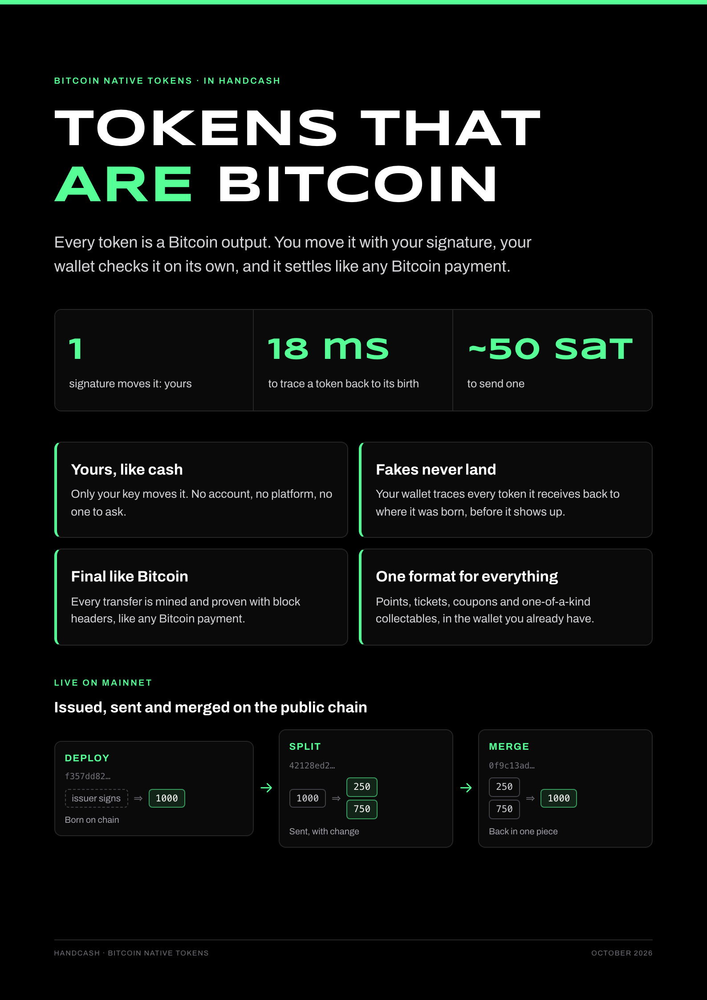

# BRC-257: Proving Service for Bitcoin Native Tokens

Brandon Cryderman / HandCash (brandongcryderman@gmail.com)

**Status:** Draft (proposed number, not a BSVA assignment)

## Abstract

A Bitcoin Native Token (BNT) recipient checks the token's history back to its deploy, and that history grows with every trade. A step proof of draft BRC-252 ([#321](https://github.com/bsv-blockchain/BRCs/pull/321)) §4 stands in for the history behind a transaction. Wallets pass step proofs to each other in the token package, and a recipient may refuse a transfer whose walk back to the newest proof is longer than its limit. Step proofs are for histories that run to millions of transfers. A wallet checks a short history itself in milliseconds (18.6 ms for three hops), while one step took about four minutes and 19 GB of memory to prove on a laptop, so wallets check proofs and do not make them. Checking a proof stays cheap at any depth.

A proving service is an overlay node that makes step proofs and serves them by txid. A sender uses one when it must pass on a proof it does not hold: a recipient's walk limit needs a newer proof than the sender has, or the sender lost one. The service is not trusted: wallets check every proof themselves, so it can refuse or delay but cannot make a false claim count. Below a recipient's limit, the sender can send the history instead, as draft BRC-255 ([#335](https://github.com/bsv-blockchain/BRCs/pull/335)) §6 says.

The service uses the standard overlay interfaces: submission under [BRC-22](./0022.md), lookup under [BRC-24](./0024.md), names under [BRC-87](./0087.md) and discovery under [BRC-88](./0088.md).

[](media/0257/bnt-brochure.pdf)

## Relationship to other documents

| Concern | Document |
|---|---|
| The BNT tests | Draft BRC-251 ([#320](https://github.com/bsv-blockchain/BRCs/pull/320)) |
| Locking scripts, proof package, validity walk | Draft BRC-255 ([#335](https://github.com/bsv-blockchain/BRCs/pull/335)) §1, §6, §7 |
| Step proofs: claim, program, accepting a step, `steps` in a package, proof types | Draft BRC-252 ([#321](https://github.com/bsv-blockchain/BRCs/pull/321)) §4 |
| Submission, lookup, names, discovery | [BRC-22](./0022.md), [BRC-24](./0024.md), [BRC-87](./0087.md), [BRC-88](./0088.md) |
| Transaction encoding | [BRC-62](../transactions/0062.md) BEEF |

MUST, MUST NOT, SHOULD and MAY are requirements on a proving service or on a wallet that uses one, as each rule says.

## Specification

### 1. Names and discovery

A proving service hosts topic manager `tm_bnt_step` and lookup service `ls_bnt_step`, and advertises them with SHIP and SLAP (BRC-88). A wallet finds services through SLAP.

### 2. Submitting

A wallet submits a transaction `T` to `/submit` with `X-Topics: ["tm_bnt_step"]` and BEEF holding `T` and every transaction `T` spends. The topic manager admits each output of `T` that reads as a BNT locking script under BRC-255 §1. Admission means the service will try to prove `T`. It does not mean `T` is valid.

A sender SHOULD submit each transfer it broadcasts, so a proof exists before the next holder needs it. A recipient MAY submit a transfer it accepts. A service treats a repeat submission of `T` as one.

### 3. Proving

The service proves `T` with the step program of BRC-252 §4 once both hold:

1. Each parent of `T` that carries an asset has a proof at the service, or is a deploy.
2. Miners have accepted `T`. A service that proves earlier risks proving a transaction that loses a double spend.

A service that lacks a parent's proof proves that parent first. When it does not hold the parent's own history, it answers that parent as unknown (§4), and a wallet MAY submit the walk's transactions oldest first, starting after the deploy.

A service MAY keep each proof in a form that is cheaper to check inside the step program, and convert it to a registered type when a wallet first looks it up. Only a type registered in BRC-252 §4 leaves the service.

### 4. Looking up

A wallet sends `/lookup` with service `ls_bnt_step` and query `{ "txids": ["<hex>", ...] }`, naming every transaction whose proof it needs in one request. A service MAY cap the list and answer the first entries it accepts.

The answer is an `output-list` with at most one entry per named transaction: its lowest-index BNT output. The proof covers the whole transaction, so the other outputs add nothing. The entry's `beef` holds the transaction, with its Merkle path once mined. The entry's `context` holds the proof:

```
context:  type length (u8) ‖ type (ASCII, e.g. "bnt-step-1") ‖ proof (encoded as BRC-252 §4 registers the type)
```

| Answer for a txid | Meaning |
|---|---|
| An entry with a proof in `context` | Proven. The wallet checks the proof under BRC-252 §4 before it uses it. |
| An entry with empty `context` | Admitted, not yet proven. The wallet asks again later, or sends the history. |
| No entry | The service does not hold the transaction. The wallet submits it, asks another service, or sends the history. |

A service SHOULD answer in the `application/octet-stream` form of BRC-24, which shares one BEEF across entries.

### 5. Keeping proofs

A proof stays useful after the outputs it covers are spent: the holder of a transfer that spends them attaches it for the recipient. A service SHOULD keep serving a proof at least until every transaction that spends the proven outputs is mined, and answers it whether or not those outputs are spent.

### 6. Policy

A service MAY charge, limit the rate of requests, or prove only the assets it chooses. Payment and authentication are layered on `/submit` and `/lookup` as BRC-22 and BRC-24 allow, for example with the paid lookup of [BRC-195](./0195.md). An issuer MAY run a service for its own asset, and a market for the assets it lists.

### 7. Wallet duties

A wallet:

1. MUST check each proof under BRC-252 §4, whatever service served it.
2. Passes on the steps it holds under BRC-252 §4. When a recipient's walk limit needs a step it does not hold, or it lost one, it looks up the proofs of the transactions it spends before it sends the transfer, and attaches them under `steps`.
3. SHOULD ask more than one service it found through SLAP.
4. Without a proof from any service, sends the history as BRC-255 §6 says, which a recipient MAY refuse past its walk limit.

A wallet is never required to prove.

## Security considerations

- A service can refuse, delay, or answer that a proof is pending. It cannot make a false claim verify. The wallet asks another service or sends the history.
- A service can serve a proof for the wrong transaction or under the wrong key. The recipient's checks under BRC-252 §4 reject it.
- A submission shows the service the transaction and the address it came from. A wallet that wants to keep its activity private submits through a relay, or does not submit and sends the history.
- A service that proves before miners accept a transaction may prove one that is never mined. That costs the service, not the recipient, who uses a step only behind a mined or accepted transaction.

## Implementations

None yet. The step program agrees with HandCash Desktop's BRC-255 rules on its test vectors. It has proved the split and the merge of a mainnet test token, the merge's proof checking the split's inside it: each is a 1,272,656-byte compressed SP1 proof, made in 239 s and 223 s on an 8 GB Apple laptop with a peak memory footprint of 19 GB. These proofs are not yet wrapped into a small proof for delivery, and the verifying key of `bnt-step-1` is not pinned, so no service can serve a checkable proof until it is. A transfer is about 1.3 million cycles, and a merge of 16 branches about 3.0 million.

## References

1. Draft BRC-251 ([#320](https://github.com/bsv-blockchain/BRCs/pull/320)) — Bitcoin Native Tokens (BNT): Definition and Wallet Duties
2. Draft BRC-252 ([#321](https://github.com/bsv-blockchain/BRCs/pull/321)) — Short Proofs for Bitcoin Native Tokens
3. Draft BRC-255 ([#335](https://github.com/bsv-blockchain/BRCs/pull/335)) — Bitcoin Native Tokens (BNT): Compact Format
4. [BRC-22](./0022.md) — Overlay Network Data Synchronization
5. [BRC-24](./0024.md) — Overlay Network Lookup Services
6. [BRC-62](../transactions/0062.md) — Background Evaluation Extended Format (BEEF) Transactions
7. [BRC-87](./0087.md) — Standardized Naming Conventions for BRC-22 Topic Managers and BRC-24 Lookup Services
8. [BRC-88](./0088.md) — Overlay Services Synchronization Architecture
9. [BRC-195](./0195.md) — Private Overlay Data and Recoverable Paid Lookup
